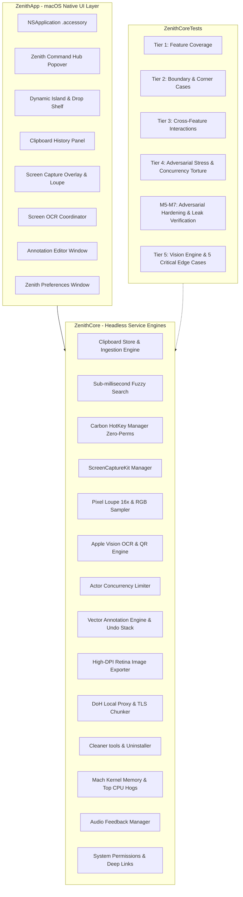

# Zenith 🌌

[](https://www.apple.com/macos/)
[](https://swift.org)
[](https://github.com/mynameisbat/zenith-macos/actions)
[](LICENSE)
[](https://mynameisbat.github.io/zenith-macos/)

**Zenith** is a premium, native macOS powerhouse utility and creative workspace built entirely with **Swift 6**, **SwiftUI**, and **AppKit**.

Zenith lives in your Menu Bar as a lightweight accessory app (no Dock icon), bringing several small utilities together in one native binary:
1. **Native Screen OCR & Barcode/QR Extractor (`⌃⌥T`)** using on-device Apple Vision, with the result copied to the clipboard.
2. **MacBook Dynamic Island & Drop Shelf** with a Now Playing display and controls (Apple Music, Spotify and browser audio), a charging HUD, and file previews.
3. **Clipboard Manager (`⌘⇧V`)** with fuzzy search, automatic exclusion of items that password managers mark as concealed, plain-text paste and optional auto-clear.
4. **Shottr-Grade Screen Capture & Annotation (`⌘⇧2`)** with a live 16x pixel Loupe magnifier.
5. **Disk cleaner, app uninstaller and process monitor (Mole-inspired)**, with a confirmation before anything is deleted.
6. **Privacy Shield**: a local proxy that looks names up over DNS-over-HTTPS and splits the TLS handshake in two. It is not a VPN and does not hide your IP address.

🗣 **Languages and accessibility:** English and Vietnamese (Zenith follows the language set in macOS). Controls have VoiceOver labels, and alerts on the island are read aloud.

🌐 **Visit the official website:** [https://mynameisbat.github.io/zenith-macos/](https://mynameisbat.github.io/zenith-macos/)

---

## 📥 Download & Installation

### Option 1: Download Pre-built DMG Installer (Recommended)
Download the latest disk image from [GitHub Releases](https://github.com/mynameisbat/zenith-macos/releases):

1. Download **`Zenith-2.5.0.dmg`** (or latest release).
2. Double-click the DMG file to mount it.
3. Drag **Zenith.app** into your **Applications** folder.
4. Launch Zenith from Spotlight or Applications.

#### Terminal / CLI Installation
```bash
# Mount DMG and copy to /Applications
hdiutil attach Zenith-2.5.0.dmg
cp -R "/Volumes/Zenith/Zenith.app" /Applications/
hdiutil detach "/Volumes/Zenith"

# Clear macOS Gatekeeper quarantine if applicable
xattr -cr /Applications/Zenith.app
open /Applications/Zenith.app
```

> **Note for macOS Gatekeeper:** Zenith is not signed with a Developer ID and is **not notarized** (that needs an Apple Developer ID), so macOS will warn about an unidentified developer. Right-click (or Control-click) `Zenith.app` in `/Applications`, select **Open**, then click **Open** in the prompt.

#### Updates
Zenith checks GitHub for a new release once a day while it runs (Settings › General › Updates; switch off **Check Automatically** to stop it) and tells you once per version. **Install and Relaunch** downloads the DMG, checks that the app inside is signed with the same certificate as the copy you are running, replaces it (the old copy goes to the Trash) and reopens Zenith; nothing is installed without that click. A copy that cannot verify an update (signed ad hoc, run from a disk image, or translocated by macOS) offers **Download…** instead, which saves the DMG in Downloads for you to install by hand. Quitting for the update turns Privacy Shield off; turn it on again afterwards.

### Option 2: Build from Source
**Prerequisites:** macOS 13.0 (Ventura) or higher, Xcode 16+ or Command Line Tools with Swift 6.0 toolchain.

```bash
# Clone the repository
git clone https://github.com/mynameisbat/zenith-macos.git
cd zenith-macos

# Run the automated test suites, one process per suite (hermetic: they never change your system proxy, Finder
# preferences or clipboard). A single `swift test` over everything can stall; see CLAUDE.md for why.
./scripts/test_each_suite.sh

# Build and assemble Zenith.app bundle
./scripts/bundle_app.sh

# Or generate a release DMG installer
./scripts/create_dmg.sh

# Launch the app
open Zenith.app
```

#### Signing your own builds
By default `bundle_app.sh` signs ad hoc, and macOS treats every rebuild as a new app, so it asks for Accessibility, Screen Recording and Automation again. Run this once to keep them:

```bash
./scripts/setup_signing.sh
```

It creates a self-signed certificate, "Zenith Local Signing", in your login keychain (no Apple Developer account needed), and `bundle_app.sh` signs with it from then on. The first build asks you to let `codesign` use the key (choose **Always Allow**), and macOS asks for the permissions one last time. The identity lives only in that Mac's keychain (back it up from Keychain Access as a `.p12`), and it does **not** get past Gatekeeper on other Macs: that still needs a paid Developer ID and notarization. `ZENITH_SIGN_IDENTITY=-` forces ad-hoc signing.

#### Releases and the update certificate
The certificate that signs a release is what installed copies trust for automatic updates: an update is installed only if it satisfies the running app's designated requirement (`identifier "com.zenith.workspace" and certificate leaf = H"…"`). So **every release must be signed with the same "Zenith Local Signing" certificate**. Back the identity up (Keychain Access › My Certificates › Export as `.p12`) and import it on any Mac that builds releases; `create_dmg.sh` prints the certificate hash to compare and refuses an ad-hoc signed app (`ZENITH_ALLOW_ADHOC_DMG=1` builds a local test DMG anyway, never publish it). If the identity is lost, installed copies refuse the next release and offer the manual download, so users install that one version by hand once; updates work again from there.

---

## ✨ Key Features & Architecture

### 1. 🎛 Menu Bar Command Hub
- Opens from the Zenith icon in the menu bar (there is no global hotkey for it). The whole app follows macOS: your accent color, Light and Dark mode, and the system's materials and controls.
- **Search**: type to filter quick actions and the running apps you can quit; Return runs the first action, and `boost` runs Boost.
- **Quick action tiles** (each shows the shortcut you set in Settings → Shortcuts):
  - **Capture Area** (`⇧⌘2`) with real-time Loupe magnifier.
  - **Capture Screen** (`⇧⌘1`).
  - **Copy Text** (`⌃⌥T`): OCR, QR codes and barcodes.
  - **Clipboard** (`⇧⌘V`).
- **Running apps**: the heaviest user processes with their app icons, memory and CPU; quit one (after a confirmation) with its ✕ or `⌘1`–`⌘4` (`SIGTERM`, then `SIGKILL` if needed).
- **Meters**: CPU, memory, free storage and battery, plus Bluetooth accessories' battery, and the download and upload speed of your Wi-Fi or Ethernet connection. The speed is measured only while the hub is open.
- **Switches**: Privacy Shield on/off, Scan/Clean system junk (asks first) and Boost; **Settings…** and **Quit Zenith** at the bottom, as in a menu.

### 2. 🔍 Native Screen OCR & Barcode/QR Extractor (`⌃⌥T`)
- **On-Device Vision**: Uses the Apple Vision framework (`VNRecognizeTextRequest`, `VNDetectBarcodesRequest`); nothing leaves your Mac.
- **Clipboard & Toast Feedback**: Snip any region of your display and the recognised text, or the payload of a QR code or barcode, is copied to the clipboard and announced with a HUD.
- **Languages**: Whatever Apple Vision supports for your system languages.
- **Actor-Isolated Concurrency Ceiling**: Throttles parallel recognition with zero memory spikes and cooperative task cancellation (`Task.isCancelled` $\rightarrow$ `VNRequest.cancel()`).

### 3. 📋 Smart Clipboard Manager (`⌘⇧V` or `⌥V`)
- **Global Hotkey (`⌘⇧V` or `⌥V`)**: Instantly opens clipboard history directly at cursor or center screen with zero Accessibility permissions required.
- **Two panes**: the history on the left, grouped by day (Today, Yesterday, Earlier), and a preview of the selected item on the right: the full text with its character, word and line counts, an image at full size, a color swatch for a hex code (`#0F62FE`), or a link with an Open button.
- **Filters**: All, Text, Links, Images and Pinned, together with search.
- **Fast search**: in-memory search over the history with Unicode-aware fuzzy matching.
- **Bounded memory**: an item over 25 MB is not kept, and the history as a whole is capped at 256 MB. The preview draws at most the first 20,000 characters.
- **Sensitive Data Exclusion**: ignores pasteboard items marked as concealed, transient or auto-generated (the `org.nspasteboard` markers), and anything copied while an app on your **ignored apps** list is in front. The list starts with common password managers (1Password, Bitwarden, KeePassXC, MacPass, Keychain Access, Passwords) and you edit it in Settings → General → Clipboard Privacy. The pasteboard is checked every half second and the front app is read at that moment, so a copy followed by a very fast switch to another app can be attributed to that other app.
- **Auto-clear** (Settings → General → Clipboard Privacy, off by default): empties the system clipboard 30 seconds, 1, 5 or 10 minutes after a copy, and optionally when the screen locks or the Mac goes to sleep. It clears only if the clipboard still holds that same copy, never touches Zenith's history, and also covers what Zenith itself puts on the clipboard and copies that were not kept.
- **Paste as plain text**: `⇧↵` in the clipboard panel, **Paste as Plain Text** in an item's right-click menu, or the button in the preview pane for rich text. The item in the history keeps its formatting.
- **Clean links**: **Paste Clean Link** in the right-click menu removes tracking parameters (`utm_*`, `fbclid`, `gclid` and similar; `si` only on YouTube and Spotify links; `ref_src` and `ref_url` only on twitter.com and x.com). Optionally (**Clean Links When I Copy Them**, off by default) Zenith rewrites the clipboard when you copy exactly one `http(s)` link that has such parameters, and the history then stores the cleaned link. A copy that carries rich text, HTML, files, images or an app's private types is never rewritten.
- **Item Pinning (`⌘P`)**: Pinned items are permanently preserved from FIFO eviction.
- **Keyboard-Driven Workflow**: a click selects, a double-click or Return pastes; `⇧↵` pastes as plain text, `⌘1`–`⌘9` instant paste, `⌘⌫` delete, `Ctrl+N` / `Ctrl+P` Emacs navigation. Right-click an item for Paste, Paste as Plain Text, Paste Clean Link (for links), Pin and Delete.

### 4. 📸 Precision Screen Capture & Annotation Editor (`⌘⇧2`)
- **Interactive 16x Loupe Magnifier**: Real-time pixel magnifier with center crosshairs and formatted RGB/HEX color sampling.
- **Vector Annotation Studio**:
  - Swept-wing vector arrows (`A`).
  - Solid and hollow rectangles (`R`).
  - Typography text callouts (`T`).
  - Pixelated / blur redaction tool (`B`) for sensitive tokens.
  - Crop (`C`).
- **100% Retina Fidelity**: Exports annotations directly at native physical display backing resolution (PNG & JPEG) with zero downsampling.
- **Rapid Keyboard Workflow**:
  - `⌘C`: Flatten annotations, copy to clipboard, and close editor.
  - `⌘S`: Export high-resolution image to disk.
  - `⌘Z` / `⇧⌘Z`: Full undo/redo command stack.
  - `Esc`: Dismiss editor safely.

### 5. 🏝 Dynamic Island, Now Playing & Battery HUD
- **Hardware-Aware Notch Integration**: Seamlessly integrates into MacBook display camera notches as well as external monitors with zero Mini-LED light bleed (`#06070a`).
- **Now Playing & Live Equalizer Visualizer**:
  - Track changes for **Apple Music** and **Spotify** arrive as system notifications (no polling); a light 1–2 s tick keeps the progress bar and other audio sources in sync.
  - **Left Wing**: Mini spinning vinyl disc with app badge / album artwork.
  - **Right Wing**: Animated jumping 4-bar equalizer visualizer with brand-matched dynamic color palettes.
  - **Expanded Player**: Hover over the island to reveal track metadata, a progress bar, and media controls (Play/Pause, Skip, Previous). The next and previous buttons are dimmed when the player does not take them (a video has no next track), and when the player accepts a position you can drag the progress bar to seek (Music and Spotify are sought over AppleScript, anything else through the system's Now Playing).
  - **Browser and other audio**: anything that reports to the system's Now Playing (Chrome-family browsers, Safari, Firefox, video players) is shown with its title, artist, artwork and position. macOS 15.4+ no longer gives this data to other apps directly, so Zenith reads it through a small helper library loaded by the system's own `perl`. A browser is shown under the browser's name.
  - **Controls**: Music and Spotify are controlled over AppleScript; anything else is sent the command through the system's Now Playing, which needs no permission. Only if macOS refuses that does Zenith fall back to the hardware media key, which needs the Accessibility permission (the island says so when macOS refuses it).
  - **Hover, click and swipe**: resting the pointer on the closed island makes it swell slightly, and it opens after a short delay if the pointer stays (0.1 to 1 second, 0.25 by default). A click opens it at once. On a trackpad or Magic Mouse, swipe down on the island to open it, up to close it, and sideways to change track (fingers left means next track).
  - **Tab Switcher**: Switch between Now Playing, Widgets and the Shelf when more than one is there; on a notched display the tabs sit either side of the notch (icons only when there are three).
- **Volume and brightness bar**: changing the volume (keys or Control Center) shows a level bar on the island. Brightness-key presses do too, read from the built-in display only; that part relies on macOS delivering the brightness keys to Zenith and has not been confirmed on a real keyboard yet. The system's own indicator still appears.
- **Full-screen apps**: the island hides while an app is full screen on its display, both a real macOS full-screen Space and an app that covers the whole display with its own window (a game, a video player). Notices then use the floating panel. An app that goes full screen without a change of app is noticed only when the pointer comes near the island, a notice is about to show, or the app is activated again.
- **Behavior settings** (Settings → Dynamic Island → Behavior): Volume and Brightness, Hover Delay, Swipe Gestures and Hide in Full-Screen Apps. Each switch can be turned off.
- **Widgets** (Settings → Dynamic Island):
  - **Focus timer**: a Pomodoro-style timer (25-minute focus, 5-minute break by default, both adjustable). While it runs, a progress ring and the time left sit either side of the notch; pause, resume or stop it from the island or from Settings. When it ends the island says so (with a sound if sound effects are on) and offers the break, or the next focus session.
  - **Next calendar event**: your next timed event in the next 12 hours (or the one going on now) with how long until it starts, in its calendar's color. Off until you turn it on; macOS then asks for Calendar access. Events are read on your Mac only, through EventKit.
  - **Network speed**: download and upload speed, next to the timer and the event. Off until you turn it on. It counts Wi-Fi, Ethernet and cellular tethering only (not VPN tunnels, which would count the same bytes twice), and measures only while the Widgets tab is showing. With all three widgets on, the event's title is shortened to fit.
- **MagSafe & USB-C Charging HUD**:
  - Driven by an IOKit run-loop notification (`IOPSNotificationCreateRunLoopSource`), not polling.
  - A green rim-light capsule shows the battery charge and the charger wattage (e.g. `Charging • 85% (67W Charger)`).
  - An unplugged notice, a low-battery alert at 20% (at most once every 5 minutes), and a full-charge notice with the battery's Maximum Capacity.
  - A battery percentage when a Bluetooth accessory connects, as far as macOS reports it (notified by the I/O Registry, not polled).
- **Interactive Drop Shelf & Quick Look Preview**:
  - Drag any file, image, or text snippet to the top edge of your screen to park it on the notch shelf.
  - High-resolution hover preview modal (`IslandPreviewWindowController`) with auto-dismiss lifecycle and drag-out staging.

### 6. 🧹 Disk Cleaner, App Uninstaller & Process Monitor (Mole-Inspired)
Nothing here deletes without asking: each action shows what will go (the largest items by name) and waits for your confirmation.

**In Settings → Cleaner** (a row of tabs: System, Projects, Installers, Leftovers, Drives). Each tab has a Scan button, a list you tick, and a confirmation that names the largest items before anything is removed.
- **System**: caches, logs and temporary files in your home folder. The Trash category is listed but unselected. It never offers Docker Desktop's virtual disk, skips Apple-managed and offline-media/sync app caches, and offers partial downloads only after a day untouched. The "Clean" badge in the Command Hub does the same, with the same confirmation.
- **Projects**: build folders (`node_modules`, Cargo `target`, `.build`, `venv`/`__pycache__`, `DerivedData`, `Pods`, …) of projects under `~/Projects`, `~/Code`, `~/Documents` and a few other usual folders, plus any folder you add. Offered only for a project type that rebuilds the folder, and `bin`/`obj`/`build`/`dist` only if Git ignores them. Moved to the Trash.
- **Installers**: `.dmg`, `.pkg`, `.iso`, `.xip` and large installer `.zip` files in Downloads and Desktop that nothing has touched for three days. A mounted disk image is left out. Moved to the Trash.
- **Leftovers**: `com.vendor.app` folders in `~/Library` whose app is gone and that nothing has touched for 30 days. **Nothing is ticked for you**: they can hold data you would want back. Moved to the Trash.
- **Drives**: Finder and Windows junk (`.DS_Store`, `._*` files, `Thumbs.db`, …) on mounted external drives (network shares are skipped). These are deleted, not trashed, and the confirmation says so.

**Scheduled Scan** (Settings → Cleaner, off by default): scans every day, every week (the default) or every 30 days, only while Zenith is running and at low priority. It only scans and never deletes: cleaning still needs your click on Clean and the usual confirmation. You get one notice (on the island, or the floating toast) when at least 1 GB can be cleaned, and not again until the amount has grown by another 1 GB. Settings → Cleaner shows the last scheduled scan and when the next is due.

**Elsewhere in the app**
- **Boost** in the Command Hub purges inactive memory and flushes the DNS cache, and tells you honestly which step failed.
- **Process monitor** in the Command Hub (see section 1).
- **Port manager** (Settings → Ports, and in the Command Hub: type a port such as `3000` or `:5432`): lists the TCP ports your processes listen on (UDP optionally) with address, PID and app, and stops one after a confirmation (`SIGTERM`, then **Force Quit** if it is still running a few seconds later). Read with `lsof` when shown, never polled. Processes of other users and of macOS are not listed or cannot be stopped.
- **App Uninstaller and Slimmer**: drop an `.app` on the island shelf. *Deep Uninstall* moves the app and its leftovers to the Trash (leftovers are matched by bundle identifier, and Apple-owned entries are never touched). *Slim* removes unused CPU architectures from a copy, verifies the code signature, swaps it in atomically and sends the original to the Trash.

### 7. 🛡 Privacy Shield (DoH + Anti-DPI Local Proxy)
- **How it works**: Zenith listens on `127.0.0.1` (port 8080 by default, loopback only) and points the macOS system proxy of your primary network service at it. It looks up the name of each site you visit over **DNS-over-HTTPS** and connects to the address it gets. Your previous proxy settings are saved and put back when you switch it off, and are repaired at the next launch if Zenith was killed while it was on.
- **DoH providers**: Cloudflare, Google, Quad9, AdGuard, NextDNS, or your own endpoint. The DoH server itself is reached by its IP address (so its name is not looked up in plain DNS) and its certificate is checked against its real name.
- **Tracker blocking** (Settings → Privacy Shield, off until you turn it on): refuses connections to advertising and tracking domains with a `403`, before any DoH lookup is made for them. It starts from a small built-in list (ad networks, ad exchanges and analytics endpoints; nothing sites need to work, such as CDNs, sign-in or tag managers) and you can **import a hosts file** or a list of domains (`0.0.0.0 ads.example.com`, one domain per line, or `||ads.example.com^` rules; up to 50 MB), add domains to **Always Block**, and list domains under **Never Block** when a site breaks. A listed domain covers its subdomains; a name with no dot (`com`) or a public suffix (`co.uk`) is refused so one bad line cannot block a whole country. Blocked requests show in the connection log and the Activity counter. Zenith never downloads a list itself: for a larger list, download a hosts file you trust (for example Steven Black's unified hosts) and import it. If Zenith is killed or crashes while the shield is on, a small separate watchdog process switches the proxy off so your internet keeps working, and the next launch restores your own earlier settings. Run from a disk image or an external drive, Zenith warns before turning the shield on, because ejecting that volume ends the app.
- **TLS ClientHello chunker**: splits the first TLS handshake packet of a connection into two pieces (after the first 2 bytes), with a 5 ms pause between them, which can defeat simple Deep Packet Inspection.
- **Turning it off**: the system proxy is put back first, the proxy stops accepting new connections, and connections other apps already have open (a download, a stream) are allowed to finish, for up to 30 seconds, before whatever is left is closed. Quitting Zenith while the shield is on ends every connection that goes through it, because those connections end inside Zenith's process.
- **Limits**: it is not a VPN and does not hide your IP address or the addresses you connect to. It only covers traffic from apps that honour the system proxy, and only the primary network service. Tracker blocking works at the domain level only: it cannot remove an ad that is served from the same domain as the page, and it does not look inside HTTPS. SOCKS and PAC proxy settings are ignored, and the local proxy has no authentication. The anti-DPI split has not been verified against a real filtering network.

### 8. 🔊 Native Audio Feedback
- 14 customizable native macOS sound cues (Pop, Tink, Hero, Bottle, Funk, Ping, Purr, Submarine, etc.) with custom sound file import (`.wav`, `.aiff`, `.m4a`).

---

## ⌨️ Keyboard Shortcuts Reference

| Shortcut | Context | Action |
| :--- | :--- | :--- |
| **Global Hotkeys** | | *(Configurable in Settings → Global Hotkeys)* |
| `⌘⇧2` | Global | Start Area Screen Capture &amp; Loupe Magnifier (Preset alt: `⌘⇧X`) |
| `⌃⌥T` | Global | Screen OCR &amp; Barcode / QR Code Recognition (not `⌘⇧3`: macOS uses that for its own screenshot) |
| `⌘⇧1` | Global | Capture Entire Active Display |
| `⌘⇧V` | Global | Open Clipboard History Manager (Preset alt: `⌥V`) |
| **Clipboard History Hub** | | *(Floating Panel &amp; Menu Bar)* |
| `↑` / `↓` | Clipboard Hub | Navigate up / down |
| `⇞` / `⇟` (PageUp/Down) | Clipboard Hub | Scroll 5 items up / down |
| `↖` / `↘` (Home / End) | Clipboard Hub | Jump to top / bottom (also `⌘↑` / `⌘↓`) |
| `Tab` / `⇧Tab` | Clipboard Hub | Cycle down / up through list |
| `⌃N` / `⌃P` | Clipboard Hub | Emacs style next / previous item (also `⌃J` / `⌃K`) |
| `↵` (Enter) | Clipboard Hub | Paste selected item into active application |
| `⇧↵` (Shift-Enter) | Clipboard Hub | Paste selected item as plain text (the history item keeps its formatting) |
| `⌘1` ... `⌘9` | Clipboard Hub | Quick select &amp; paste item 1–9 |
| `⌘⌫` / `⌦` | Clipboard Hub | Delete selected clip from history |
| `⌘P` | Clipboard Hub | Toggle pin status on selected clip |
| **Annotation Editor** | | *(Post-Capture Canvas)* |
| `P` | Annotation Editor | Select Pen (Freehand Draw) Tool |
| `A` | Annotation Editor | Select Arrow Tool |
| `R` | Annotation Editor | Select Rectangle Tool |
| `T` | Annotation Editor | Select Text Label Tool |
| `B` | Annotation Editor | Select Blur / Pixelate Privacy Tool |
| `C` | Annotation Editor | Select Crop Tool |
| `1` ... `8` | Annotation Editor | Quick select palette colors 1–8 |
| `[` / `]` | Annotation Editor | Decrease / Increase stroke width |
| `⌘C` | Annotation Editor | Copy annotated image to clipboard and dismiss |
| `⌘S` | Annotation Editor | Save annotated image to disk |
| `⌘Z` / `⇧⌘Z` | Annotation Editor | Undo / Redo drawing action |
| **General &amp; Menu Bar** | | |
| `Esc` | Any Modal / Editor | Dismiss / Cancel |
| `⌘,` | Menu Bar Hub | Open Zenith Settings |
| `⌘Q` | Menu Bar Hub | Quit Zenith |

---

## 🔒 System Permissions Guide

Zenith is designed with privacy-first principles and minimal permission requirements. Settings → Permissions shows one card per permission (Screen Recording, Accessibility, Automation, Calendars): its state, what it is for, what still works without it and which features use it. It warns when a permission is granted but nothing you turned on uses it (today only Calendars can show that, because it is the only feature with a switch), and hints when a feature that is on lacks its permission. It never asks for a permission itself; Automation shows as "asked per app" because macOS reports it only per target app.

1. **Screen Recording (`kTCCServiceScreenCapture`)** — **Required for Capture**:
   - Required by Apple's `ScreenCaptureKit` to capture displays, coordinate marquee crops, and sample RGB pixels in the loupe magnifier.
   - **How to enable**: macOS will prompt automatically on your first screenshot. Alternatively, open:
     *System Settings → Privacy & Security → Screen Recording → Toggle Zenith ON*.
   - **Deep Link**: `open "x-apple.systempreferences:com.apple.preference.security?Privacy_ScreenCapture"`
   - **macOS Sequoia / Sonoma Note**: After toggling Screen Recording ON, click **Quit & Reopen** when prompted by macOS for the new display capture entitlements to take effect.

2. **Accessibility (`kTCCServiceAccessibility`)** — **Optional**:
   - **Zero-Permission Hotkeys**: Zenith uses macOS Carbon Event HotKeys for all global triggers (`⌘⇧V`, `⌘⇧2`, `⌘⇧1`), which require **zero Accessibility permissions**.
   - **What Accessibility is for**: it lets Zenith synthesize keystrokes: `⌘V` to paste a clipboard item straight into the front app (`AutoPasteService`), and, as a fallback, the media keys that control playback from the island.
   - Without it, selecting an item only copies it (paste with `⌘V` yourself), and if macOS refuses a playback command from the island, the media-key fallback is unavailable (it shows an "Allow Accessibility" notice).

3. **Automation (Apple Events)** — **Optional**:
   - Lets Zenith control Music and Spotify, read Music's artwork, and ask Finder to move protected leftovers to the Trash (Cleaner → Leftovers). macOS asks the first time, once per app.

4. **Calendars** — **Optional**:
   - Only for the island's "Next calendar event" widget. macOS asks when you turn the widget on in Settings → Dynamic Island, never before. Without it the widget shows how to allow it. (A build run with `swift run` has no Info.plist, so it cannot ask; use the bundled `Zenith.app`.)

---

## 🧪 Architecture & Quality Verification

Zenith is engineered with clean modularity and strict Swift 6 concurrency safety:



```
┌────────────────────────────────────────────────────────┐
│                ZenithApp (Executable)                  │
│  - NSApplication (.accessory policy)                   │
│  - Status Bar Controller & Menu Bar Popover            │
│  - Screen OCR Coordinator, Dynamic Island Shelf        │
└───────────────────────────┬────────────────────────────┘
                            │ consumes
┌───────────────────────────▼────────────────────────────┐
│                 ZenithCore (Library)                   │
│  - Headless, decoupled core engines                    │
│  - Apple Vision OCR & Barcode, ScreenCaptureKit        │
│  - Deep Purge, TLS Chunker, Hardware Telemetry         │
│  - 100% verifiable via automated Swift Testing suites │
└───────────────────────────▲────────────────────────────┘
                            │ verified by
┌───────────────────────────┴────────────────────────────┐
│         ZenithCoreTests                                 │
│  - Tier 1-4: Core features, boundaries & torture       │
│  - Tier 5: Vision OCR & 5 Critical Edge Cases (39 tests)│
│  - Zero regressions, verified Swift 6 strict concurrency│
└────────────────────────────────────────────────────────┘
```

Run the test suites (one process per suite, as CI does):
```bash
./scripts/test_each_suite.sh
```
CI (`.github/workflows/tests.yml`) skips four suites that create a menu-bar item or a window, because the runner has no window server; run them on a Mac with `ONLY_SUITES="MenuBarControllerTests" ./scripts/test_each_suite.sh`. Suites that touch the system or the network are opt-in: `ZENITH_E2E_SYSTEM=1` (changes the real system proxy) and `ZENITH_E2E_NETWORK=1` (uses the internet).

---

## 📄 License

Zenith is open source under the [MIT License](LICENSE).
