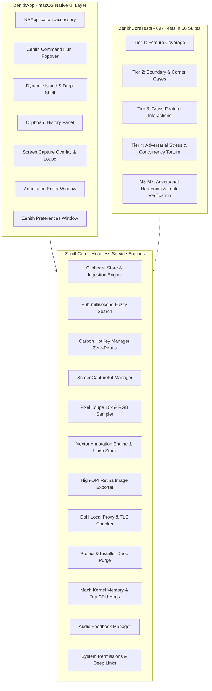

# Zenith 🌌

[](https://www.apple.com/macos/)
[](https://swift.org)
[](https://github.com/mynameisbat/zenith-macos/actions)
[](LICENSE)
[](https://mynameisbat.github.io/zenith-macos/)

**Zenith** is a premium, native macOS powerhouse utility and creative workspace built entirely with **Swift 6**, **SwiftUI**, and **AppKit**.

Zenith lives quietly in your Menu Bar as an ultra-lightweight accessory (idle RAM ~28 MB), replacing scattered, battery-draining Electron apps with a single, unified high-performance binary:
1. **Smart In-Memory Clipboard Manager** with sub-millisecond fuzzy search and password protection.
2. **Shottr-Grade Screen Capture & Annotation** with a live 16x pixel Loupe magnifier.
3. **MacBook Dynamic Island & Drop Shelf** for temporary file parking and status capsules.
4. **Developer Deep Purge (Mole-Inspired)** to reclaim tens of gigabytes from `node_modules`, Xcode `DerivedData`, and stale `.dmg` installers.
5. **Privacy Shield (DNS-over-HTTPS + Anti-DPI)** with in-process TLS ClientHello SNI chunking without VPN ping overhead.

🌐 **Visit the official website:** [https://mynameisbat.github.io/zenith-macos/](https://mynameisbat.github.io/zenith-macos/)

---

## 📥 Download & Installation

### Option 1: Download Pre-built DMG Installer (Recommended)
Download the latest disk image from [GitHub Releases](https://github.com/mynameisbat/zenith-macos/releases):

1. Download **`Zenith-2.0.0.dmg`**.
2. Double-click the DMG file to mount it.
3. Drag **Zenith.app** into your **Applications** folder.
4. Launch Zenith from Spotlight or Applications.

#### Terminal / CLI Installation
```bash
# Mount DMG and copy to /Applications
hdiutil attach Zenith-2.0.0.dmg
cp -R "/Volumes/Zenith/Zenith.app" /Applications/
hdiutil detach "/Volumes/Zenith"

# Clear macOS Gatekeeper quarantine if applicable
xattr -cr /Applications/Zenith.app
open /Applications/Zenith.app
```

> **Note for macOS Gatekeeper:** If macOS warns about an unidentified developer, right-click (or Control-click) `Zenith.app` in `/Applications` and select **Open**, then click **Open** in the prompt.

### Option 2: Build from Source
**Prerequisites:** macOS 14.0 (Sonoma) or higher, Xcode 16+ or Command Line Tools with Swift 6.0 toolchain.

```bash
# Clone the repository
git clone https://github.com/mynameisbat/zenith-macos.git
cd zenith-macos

# Run automated test suites (697/697 tests in 66 suites)
swift test

# Build and assemble Zenith.app bundle
./scripts/bundle_app.sh

# Or generate a release DMG installer
./scripts/create_dmg.sh

# Launch the app
open Zenith.app
```

---

## ✨ Key Features & Architecture

### 1. 🎛 Menu Bar Command Hub (`⌥Space`)
- Minimalist macOS popover designed with Precision Apple Sapphire Blue (`#0F62FE`).
- **Instant Search**: Type to search across all your clipboard items, launch screen captures, or run system cleaner actions.
- **Direct Quick Action Tiles**:
  - **Capture Area** (`⌘⇧2`) with real-time Loupe magnifier.
  - **Capture Screen** (`⌘⇧1`).
  - **Open Preferences** (`⌘,`).
- **Live System Telemetry**: Displays real-time CPU usage, RAM pressure, and Privacy Shield active status.

### 2. 📋 Smart Clipboard Manager (`⌘⇧V` or `⌥V`)
- **Global Hotkey (`⌘⇧V` or `⌥V`)**: Instantly opens clipboard history directly at cursor or center screen with zero Accessibility permissions required.
- **Sub-Millisecond Search**: In-memory UTF-8 Boyer-Moore algorithm and Unicode fuzzy search for instant recall under 0.65ms.
- **Sensitive Data Auto-Exclusion**: Automatically detects and ignores sensitive pasteboard data from 1Password, Bitwarden, KeePassXC, and Apple Keychain.
- **Item Pinning (`⌘P`)**: Pinned items are permanently preserved from FIFO eviction.
- **Keyboard-Driven Workflow**: `⌘1`–`⌘9` instant paste, `⌘⌫` delete, `Ctrl+N` / `Ctrl+P` Emacs navigation.

### 3. 📸 Precision Screen Capture & Annotation Editor (`⌘⇧2`)
- **Interactive 16x Loupe Magnifier**: Real-time pixel magnifier with center crosshairs and formatted RGB/HEX color sampling.
- **Vector Annotation Studio**:
  - Swept-wing vector arrows (`A`).
  - Numbered step badges `①`, `②`, `③` (`S`).
  - Solid and hollow rectangles (`R`).
  - Typography text callouts (`T`).
  - Pixelated / blur redaction tool (`B`) for sensitive tokens.
- **100% Retina Fidelity**: Exports annotations directly at native physical display backing resolution (PNG & JPEG) with zero downsampling.
- **Rapid Keyboard Workflow**:
  - `⌘C`: Flatten annotations, copy to clipboard, and close editor.
  - `⌘S`: Export high-resolution image to disk.
  - `⌘Z` / `⇧⌘Z`: Full undo/redo command stack.
  - `Esc`: Dismiss editor safely.

### 4. 🏝 Dynamic Island & Drop Shelf
- **Hardware-Aware Notch Integration**: Seamlessly integrates into MacBook display camera notches as well as external monitors.
- **Interactive Drop Shelf**: Drag any file, image, or snippet to the top of your screen to park it in the notch shelf. Switch spaces, apps, or fullscreens and drag it out.
- **Transient Status HUD Capsules**: Symmetrical 120Hz ProMotion spring expansion for transient feedback on copy, capture, and cache cleaning.
- **Zero Mini-LED Light Bleed**: Engineered with pure obsidian black `#06070a` matching MacBook Liquid Retina XDR Mini-LED bezels without glowing halos.

### 5. 🧹 Developer Deep Purge (Mole-Inspired)
- **Project Build Artifact Purge**: Recursively scans and purges heavy build directories:
  - `node_modules` & `pnpm` stores (Node.js/TypeScript).
  - Xcode `DerivedData` & Device Simulator runtimes.
  - Cargo `target/` (Rust).
  - `.venv` & `__pycache__` (Python).
  - Swift Package Manager `.build/`.
- **Stale Installer Hunt**: Discovers multi-gigabyte `.dmg`, `.pkg`, and `.iso` installers sitting in `~/Downloads` that have already been installed.
- **App Uninstaller**: Eradicates `.app` bundles along with orphaned leftovers hidden in `~/Library/Application Support`, `~/Library/Caches`, and `LaunchAgents`.
- **Hardware Telemetry Service**: Real-time memory pressure telemetry and active Top CPU Hogs process monitor with graceful `SIGTERM` and `SIGKILL`.

### 6. 🛡 Privacy Shield (DoH + Anti-DPI Local Proxy)
- **DNS-over-HTTPS (DoH)**: Built-in local resolver routing system DNS requests over encrypted HTTPS to **Cloudflare** (`1.1.1.1`) or **Google** (`8.8.8.8`).
- **TLS ClientHello SNI Chunker**: Splits the initial TLS handshake packet into dual micro-chunks directly on `127.0.0.1:8080`, evading Deep Packet Inspection (DPI) firewalls with **zero ping latency penalty** and without third-party VPN subscriptions.

### 7. 🔊 Native Audio Feedback
- 14 customizable native macOS sound cues (Pop, Tink, Hero, Bottle, Funk, Ping, Purr, Submarine, etc.) with custom sound file import (`.wav`, `.aiff`, `.m4a`).

---

## ⌨️ Keyboard Shortcuts Reference

| Shortcut | Context | Action |
| :--- | :--- | :--- |
| **Global Hotkeys** | | *(Configurable in Settings → Global Hotkeys)* |
| `⌘⇧2` | Global | Start Area Screen Capture &amp; Loupe Magnifier (Preset alt: `⌘⇧X`) |
| `⌘⇧1` | Global | Capture Entire Active Display |
| `⌘⇧V` | Global | Open Clipboard History Manager (Preset alt: `⌥V`) |
| `⌥Space` | Global | Open Zenith Command Hub Popover |
| **Clipboard History Hub** | | *(Floating Panel &amp; Menu Bar)* |
| `↑` / `↓` | Clipboard Hub | Navigate up / down |
| `⇞` / `⇟` (PageUp/Down) | Clipboard Hub | Scroll 5 items up / down |
| `↖` / `↘` (Home / End) | Clipboard Hub | Jump to top / bottom (also `⌘↑` / `⌘↓`) |
| `Tab` / `⇧Tab` | Clipboard Hub | Cycle down / up through list |
| `⌃N` / `⌃P` | Clipboard Hub | Emacs style next / previous item (also `⌃J` / `⌃K`) |
| `↵` (Enter) | Clipboard Hub | Paste selected item into active application |
| `⌘1` ... `⌘9` | Clipboard Hub | Quick select &amp; paste item 1–9 |
| `⌘⌫` / `⌦` | Clipboard Hub | Delete selected clip from history |
| `⌘P` | Clipboard Hub | Toggle pin status on selected clip |
| **Annotation Editor** | | *(Post-Capture Canvas)* |
| `P` | Annotation Editor | Select Pen (Freehand Draw) Tool |
| `A` | Annotation Editor | Select Arrow Tool |
| `R` | Annotation Editor | Select Rectangle Tool |
| `T` | Annotation Editor | Select Text Label Tool |
| `B` | Annotation Editor | Select Blur / Pixelate Privacy Tool |
| `S` | Annotation Editor | Select Numbered Step Badge Tool (①, ②, ③) |
| `1` ... `8` | Annotation Editor | Quick select palette colors 1–8 |
| `[` / `]` | Annotation Editor | Decrease / Increase stroke width |
| `⌘C` | Annotation Editor | Copy annotated image to clipboard and dismiss |
| `⌘S` | Annotation Editor | Save annotated image to disk |
| `⌘Z` / `⇧⌘Z` | Annotation Editor | Undo / Redo drawing action |
| **General &amp; Menu Bar** | | |
| `Esc` | Any Modal / Editor | Dismiss / Cancel |
| `⌘,` | Menu Bar Hub | Open Zenith Settings |
| `⌘Q` | Menu Bar Hub | Quit Zenith |

---

## 🔒 System Permissions Guide

Zenith is designed with privacy-first principles and minimal permission requirements:

1. **Screen Recording (`kTCCServiceScreenCapture`)** — **Required for Capture**:
   - Required by Apple's `ScreenCaptureKit` to capture displays, coordinate marquee crops, and sample RGB pixels in the loupe magnifier.
   - **How to enable**: macOS will prompt automatically on your first screenshot. Alternatively, open:
     *System Settings → Privacy & Security → Screen Recording → Toggle Zenith ON*.
   - **Deep Link**: `open "x-apple.systempreferences:com.apple.preference.security?Privacy_ScreenCapture"`
   - **macOS Sequoia / Sonoma Note**: After toggling Screen Recording ON, click **Quit & Reopen** when prompted by macOS for the new display capture entitlements to take effect.

2. **Accessibility (`kTCCServiceAccessibility`)** — **Optional**:
   - **Zero-Permission Hotkeys**: Zenith uses macOS Carbon Event HotKeys for all global triggers (`⌘⇧V`, `⌘⇧2`, `⌘⇧1`), which require **zero Accessibility permissions**.
   - **What Accessibility is for**: Enabling Accessibility allows Zenith's `AutoPasteService` to synthesize a native `⌘V` keystroke to paste directly into your background application upon selection.
   - If Accessibility is not enabled, selecting an item copies it to your clipboard with a toast notification, allowing you to paste manually with `⌘V`.

---

## 🧪 Architecture & Quality Verification

Zenith is engineered with clean modularity and strict Swift 6 concurrency safety:



```
┌────────────────────────────────────────────────────────┐
│                ZenithApp (Executable)                  │
│  - NSApplication (.accessory policy)                   │
│  - Status Bar Controller & Menu Bar Popover            │
│  - Dynamic Island Drop Shelf, Annotation Editor        │
└───────────────────────────┬────────────────────────────┘
                            │ consumes
┌───────────────────────────▼────────────────────────────┐
│                 ZenithCore (Library)                   │
│  - Headless, decoupled core engines                    │
│  - ScreenCaptureKit backend, HotKey parser, Proxy      │
│  - Deep Purge, TLS Chunker, Hardware Telemetry         │
│  - 100% verifiable via automated Swift Testing suites │
└───────────────────────────▲────────────────────────────┘
                            │ verified by
┌───────────────────────────┴────────────────────────────┐
│         ZenithCoreTests (697 tests / 66 suites)        │
│  - Tier 1: Feature coverage                            │
│  - Tier 2: Boundary & corner cases                     │
│  - Tier 3: Cross-feature interactions                  │
│  - Tier 4: Adversarial stress & memory torture         │
└────────────────────────────────────────────────────────┘
```

Run test suite:
```bash
swift test
```

---

## 📄 License

Zenith is open source under the [MIT License](LICENSE).
