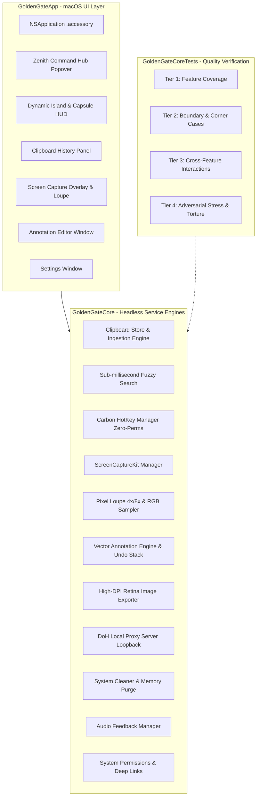

# Zenith 🌌

A premium, native macOS utility and creative workstation built with **Swift 6**, **SwiftUI**, and **AppKit**.

Zenith lives quietly in your Menu Bar as a high-performance accessory, bringing together smart clipboard history, precision screen capture with vector annotations, Dynamic Island HUD capsules, DoH privacy DNS shield, and system cache cleaning into a cohesive, native macOS experience.

---

## 📥 Download & Installation

### Option 1: Download Pre-built DMG Installer (Recommended)
Download the latest disk image from [GitHub Releases](https://github.com/mynameisbat/zenith/releases) or build it locally:

1. Download **`Zenith-2.0.0.dmg`**.
2. Double-click the DMG file to mount it.
3. Drag **Zenith.app** into your **Applications** folder.
4. Launch Zenith from Spotlight or Applications.

#### Terminal / CLI Installation
```bash
# Mount DMG and copy to /Applications
hdiutil attach Zenith-2.0.0.dmg
cp -R "/Volumes/Zenith/Zenith.app" /Applications/
hdiutil detach "/Volumes/Zenith"

# Clear macOS Gatekeeper quarantine if applicable
xattr -cr /Applications/Zenith.app
open /Applications/Zenith.app
```

> **Note for macOS Gatekeeper:** If macOS warns about an unidentified developer, right-click (or Control-click) `Zenith.app` in `/Applications` and select **Open**, then click **Open** in the prompt.

### Option 2: Build from Source
**Prerequisites:** macOS 14.0 (Sonoma) or higher, Xcode 16+ or Command Line Tools with Swift 6.0 toolchain.

```bash
# Clone the repository
git clone https://github.com/mynameisbat/zenith.git
cd zenith

# Run automated test suites (658/658 tests)
swift test

# Build and assemble Zenith.app bundle
./scripts/bundle_app.sh

# Or generate a release DMG installer
./scripts/create_dmg.sh

# Launch the app
open Zenith.app
```

---

## ✨ Key Features

### 1. 🎛 Menu Bar Command Hub
- Minimalist macOS Sequoia popover designed with frosted glass vibrancy (`.ultraThinMaterial`).
- Instant search bar filtering clipboard items and actions.
- Direct quick action tiles for **Capture Area** (`⌘⇧2`) and **Capture Screen** (`⌘⇧1`).
- Recent clipboard stream with type-aware previews and single-click paste.
- Subtle system telemetry footer displaying DoH Shield status and cleanable cache space.

### 2. 📋 Smart Clipboard Manager
- **Global Hotkey (`⌘⇧V` or `⌥V`)**: Instantly opens clipboard history directly at cursor or center screen.
- **Fuzzy Search Engine**: Sub-millisecond search across plain text, rich text, code snippets, and images.
- **Password Manager Protection**: Automatically detects and ignores sensitive pasteboard data from 1Password, Bitwarden, KeePassXC, and concealed types.
- **Pin Items**: Immune from FIFO eviction limits.

### 3. 📸 Precision Screen Capture & Annotation Editor
- **Interactive Loupe Magnifier**: Real-time pixel loupe with RGB color sampling and dimension badges for pixel-perfect cropping.
- **Vector Annotation Tools**: Freehand pen, arrows with swept-back wings, rectangles, text labels, and privacy pixelation/blur.
- **100% Retina Fidelity**: Exports annotations directly at native physical display backing resolution (PNG & JPEG).
- **Rapid Keyboard Workflow**:
  - `⌘C`: Flatten annotations, copy to clipboard, and close editor.
  - `⌘S`: Export high-resolution image to disk.
  - `⌘Z` / `⇧⌘Z`: Full undo/redo history.
  - `Esc`: Dismiss editor safely.

### 4. 🏝 Dynamic Island & Alert Capsule
- **Hardware-Aware Geometry**: Seamlessly adapts to MacBook physical display notches as well as external monitors.
- **Fluid Spring Physics**: Symmetrical 120Hz ProMotion spring expansion without horizontal drift.
- **Alert Capsule HUD**: Transient HUD for copy/capture actions unified inside the notch capsule.

### 5. 🛡 DoH (DNS-over-HTTPS) Privacy Shield
- In-process local DNS proxy server with loopback-only binding guards and SSRF prevention.
- Seamlessly re-routable upstream providers: **Cloudflare**, **Google**, **AdGuard**, **Quad9**, **NextDNS**, or custom DoH URLs.

### 6. 🧹 System Cleaner & RAM Purge
- Safe cache cleaner inspecting developer caches (Xcode DerivedData, CocoaPods, Gradle, Cargo) and browser caches.
- Real-time Mach kernel memory telemetry and safe inactive RAM pressure relief.

### 7. 🔊 Audio Feedback
- 14 customizable native macOS sound cues (Pop, Tink, Hero, Bottle, Funk, Ping, Purr, Submarine, etc.) with custom sound file import (`.wav`, `.aiff`, `.m4a`).

---

## ⌨️ Global & In-App Keyboard Shortcuts

| Shortcut | Context | Action |
| :--- | :--- | :--- |
| **Global Hotkeys** | | *(Configurable in Settings → Global Hotkeys)* |
| `⌘⇧2` | Global | Start Area Screen Capture (Preset alt: `⌘⇧X`) |
| `⌘⇧1` | Global | Capture Entire Active Display |
| `⌘⇧V` | Global | Open Clipboard History Manager (Preset alt: `⌥V`) |
| **Clipboard History Hub** | | *(Floating Panel & Menu Bar)* |
| `↑` / `↓` | Clipboard Hub | Navigate up / down |
| `⇞` / `⇟` (PageUp/Down) | Clipboard Hub | Scroll 5 items up / down |
| `↖` / `↘` (Home / End) | Clipboard Hub | Jump to top / bottom (also `⌘↑` / `⌘↓`) |
| `Tab` / `⇧Tab` | Clipboard Hub | Cycle down / up through list |
| `⌃N` / `⌃P` | Clipboard Hub | Emacs style next / previous item (also `⌃J` / `⌃K`) |
| `↵` (Enter) | Clipboard Hub | Paste selected item into active application |
| `⌘1` ... `⌘9` | Clipboard Hub | Quick select & paste item 1–9 |
| `⌘⌫` / `⌦` | Clipboard Hub | Delete selected clip from history |
| `⌘P` | Clipboard Hub | Toggle pin status on selected clip |
| **Annotation Editor** | | *(Post-Capture Canvas)* |
| `P` | Annotation Editor | Select Pen (Freehand Draw) Tool |
| `A` | Annotation Editor | Select Arrow Tool |
| `R` | Annotation Editor | Select Rectangle Tool |
| `T` | Annotation Editor | Select Text Label Tool |
| `B` | Annotation Editor | Select Blur / Pixelate Privacy Tool |
| `C` | Annotation Editor | Select Crop Tool |
| `1` ... `8` | Annotation Editor | Quick select palette colors 1–8 |
| `[` / `]` | Annotation Editor | Decrease / Increase stroke width (2pt, 4pt, 8pt) |
| `⌘C` | Annotation Editor | Copy annotated image to clipboard and dismiss |
| `⌘S` | Annotation Editor | Save annotated image to disk |
| `⌘Z` | Annotation Editor | Undo last drawing action |
| `⇧⌘Z` | Annotation Editor | Redo drawing action |
| **Screen Capture Overlay** | | *(Active Screen Selection)* |
| `Z` | Capture Overlay | Toggle pixel loupe zoom between 4x and 8x |
| **General & Menu Bar** | | |
| `Esc` | Any Modal / Editor | Dismiss / Cancel |
| `⌘1` ... `⌘4` | Menu Bar Hub | Quick select recent item in Menu Bar popover |
| `⌘,` | Menu Bar Hub | Open Zenith Settings |
| `⌘Q` | Menu Bar Hub | Quit Zenith |

---

## 🔒 System Permissions Guide

Zenith is designed with privacy-first principles and minimal permission requirements:

1. **Screen Recording (`kTCCServiceScreenCapture`)** — **Required for Capture**:
   - Required by Apple's `ScreenCaptureKit` to capture screen displays, coordinate marquee crops, and sample RGB pixels in the loupe magnifier.
   - **How to enable**: macOS will prompt automatically on your first screenshot. Alternatively, open:
     *System Settings → Privacy & Security → Screen Recording → Toggle Zenith ON*.
   - **Deep Link**: `open "x-apple.systempreferences:com.apple.preference.security?Privacy_ScreenCapture"`
   - **macOS Sequoia / Sonoma Note**: After toggling Screen Recording ON, click **Quit & Reopen** when prompted by macOS for the new display capture entitlements to take effect.

2. **Accessibility (`kTCCServiceAccessibility`)** — **Optional**:
   - **Zero-Permission Hotkeys**: Zenith uses macOS Carbon Event HotKeys for all global triggers (`⌘⇧V`, `⌘⇧2`, `⌘⇧1`), which require **zero Accessibility permissions**.
   - **What Accessibility is for**: Enabling Accessibility allows Zenith's `AutoPasteService` to synthesize a native `⌘V` keystroke to paste directly into your background application upon selection.
   - If Accessibility is not enabled, selecting an item copies it to your clipboard with a toast notification, allowing you to paste manually with `⌘V`.
   - **How to enable**:
     *System Settings → Privacy & Security → Accessibility → Toggle Zenith ON*.
   - **Deep Link**: `open "x-apple.systempreferences:com.apple.preference.security?Privacy_Accessibility"`

> **Troubleshooting Permissions:** To reset permissions during testing:
> ```bash
> tccutil reset ScreenCapture com.zenith.workspace
> tccutil reset Accessibility com.zenith.workspace
> ```

---

## 🧪 Architecture & Quality Verification

Zenith is engineered with clean modularity and strict Swift 6 concurrency safety:



```
┌────────────────────────────────────────────────────────┐
│               GoldenGateApp (Executable)               │
│  - NSApplication (.accessory policy)                   │
│  - Status Bar Controller & Menu Bar Popover            │
│  - Dynamic Island, Annotation Editor, Settings Window  │
└───────────────────────────┬────────────────────────────┘
                            │ consumes
┌───────────────────────────▼────────────────────────────┐
│                GoldenGateCore (Library)                │
│  - Headless, decoupled core engines                    │
│  - ScreenCaptureKit backend, HotKey parser, Proxy      │
│  - 100% verifiable via automated Swift Testing suites │
└───────────────────────────▲────────────────────────────┘
                            │ verified by
┌───────────────────────────┴────────────────────────────┐
│         GoldenGateCoreTests (658 tests / 59 suites)    │
│  - Tier 1: Feature coverage                            │
│  - Tier 2: Boundary & corner cases                     │
│  - Tier 3: Cross-feature interactions                  │
│  - Tier 4: Adversarial stress & concurrency torture    │
└────────────────────────────────────────────────────────┘
```

Run test suite:
```bash
swift test
```

---

## 📄 License

Zenith is open source under the [MIT License](LICENSE).
